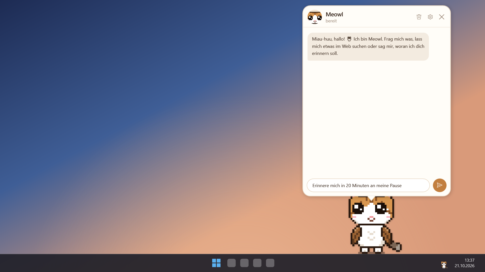
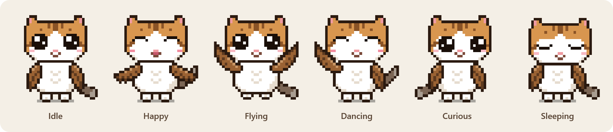
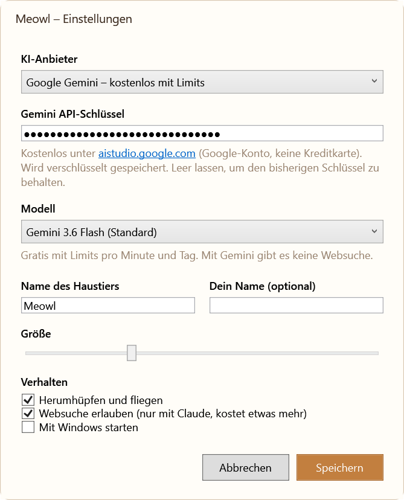
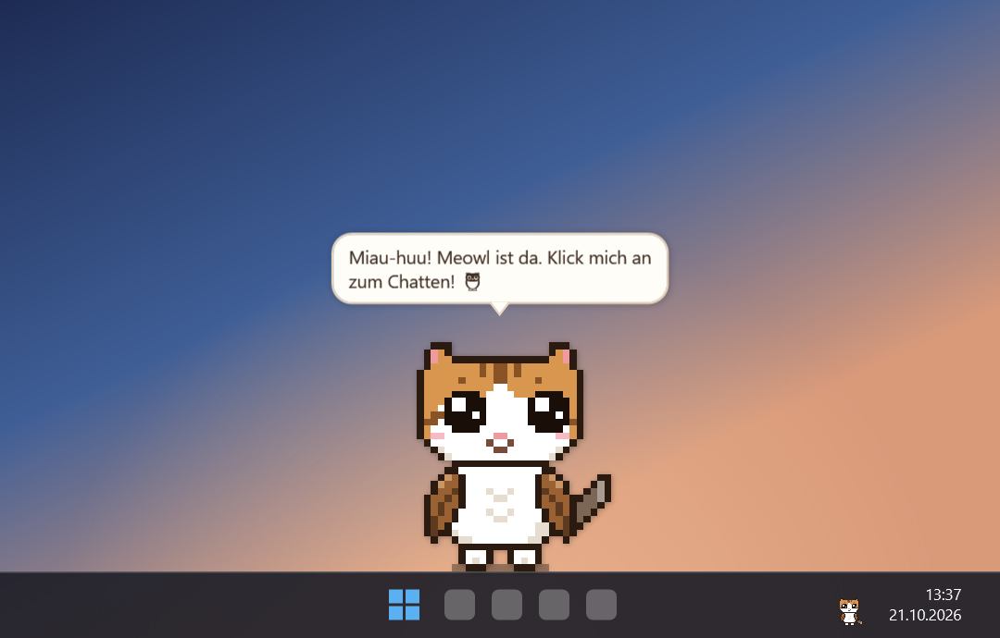

# Meowl 🦉🐱 – a pixel-art desktop pet powered by Claude

**Meowl** (meow + owl) is a tiny cat-owl that lives on top of your Windows taskbar.
It hops around, flies, falls asleep when you ignore it, and when you click it,
a chat bubble opens: Meowl is a real AI assistant (Claude) that can search the web,
set reminders, take notes and more.



<p align="center">
  
</p>

> 🇩🇪 Die App selbst ist auf Deutsch. Eine deutsche Kurzanleitung findest du [weiter unten](#-deutsch-kurzanleitung).

## Features

- **Pixel-art pet** – 32×36 hand-made sprite, crisp at every size, eyes follow your mouse
- **Alive** – hops, flies across the screen, flaps its wings, wags its tail, blinks, falls asleep after a while
- **Interactive** – drag it around (it flutters back down), pet it by moving the mouse over it, right-click for a menu
- **AI chat** – click it and talk to Claude or, for free, Google Gemini in a speech bubble
- **Agent tools** – web search, reminders, notes, clipboard, opening links and a few safe programs, PC info, and it can trigger its own animations ("dance for me!")
- **Private and safe** – API key encrypted with Windows DPAPI, no telemetry, tools can't delete anything or run arbitrary commands

## Quick start

1. **Download** `Meowl.exe` from the [latest release](../../releases/latest).
   It's a single file, no installation and no .NET needed.
2. **Run it.** Windows SmartScreen may warn you because the exe isn't code-signed:
   click *More info* → *Run anyway*.
3. **Add an API key:** right-click Meowl → *Einstellungen* (settings) → pick the provider (*Claude* or *Google Gemini*, which is free) → paste the key → *Speichern*.
4. **Click Meowl** to chat. 🎉

### Getting a Claude API key

1. Sign up at [console.anthropic.com](https://console.anthropic.com/).
2. Add a little credit under *Billing* (a few dollars last a long time, see [costs](#costs)).
3. Go to [*API Keys*](https://console.anthropic.com/settings/keys) → *Create Key*, and copy the key (`sk-ant-...`).

Alternatively, Meowl uses the `ANTHROPIC_API_KEY` environment variable if no key is saved.

### Looking for a free API key?

Check out **[awesome-freellm-apis](https://github.com/open-free-llm-api/awesome-freellm-apis)**, a daily updated list
of LLM providers with free tiers (Google Gemini, Groq, Mistral and many more) including direct links to get a key.

> Meowl supports **Google Gemini** out of the box, see [the free Gemini key](#getting-a-free-google-gemini-key) below.

### Getting a free Google Gemini key

1. Open [aistudio.google.com/app/apikey](https://aistudio.google.com/app/apikey) and sign in with a Google account (no credit card).
2. Click *Create API key* and copy it.
3. In Meowl's settings choose **Google Gemini** as provider and paste the key.

The free tier has per-minute and daily limits. If Meowl says the limit is reached, wait a minute or switch to *Flash-Lite*.
Alternatively, Meowl uses the `GOOGLE_API_KEY` or `GEMINI_API_KEY` environment variable.

<p align="center">
  
  &nbsp;
  
</p>

## How to use

| What | How |
|---|---|
| Chat | Left-click Meowl, or left-click the tray icon, or start `Meowl.exe` again |
| Carry it | Drag with the left mouse button and let go, it flutters back to the taskbar |
| Pet it | Move the mouse back and forth over it (no click), hearts appear |
| Menu | Right-click: fly, dance, sleep, stay in place, notes, settings, quit |
| Wake it up | It falls asleep after 4 minutes without attention, a click wakes it |
| New conversation | Trash icon in the chat header |

### What Meowl can do for you

Just ask in the chat, e.g. *"Remind me in 20 minutes to take a break"*,
*"What's the weather in Zurich?"*, *"Translate what I copied"* or *"Dance!"*.

| Tool | Notes |
|---|---|
| Web search | Can be turned off in the settings |
| Date and time | |
| Reminders | Meowl wakes up, plays a sound and shows the reminder (only while the app runs) |
| Notes | Saved to `%APPDATA%\Meowl\notizen.md` |
| Read clipboard | Only text, only when you ask |
| Open links | Only `http`/`https` |
| Open programs | Only Notepad, Calculator, Explorer, Paint, Settings, Task Manager, Snipping Tool |
| PC info | Battery, memory, disk space, uptime |
| Animations | Happy, dance, fly, sleep |

Meowl **can't** delete files, run shell commands or access anything else on your PC.

## Costs

Meowl uses the Claude API, which is pay-per-use. Rough cost per chat message:

| Model (choose in settings) | Per message |
|---|---|
| Claude Opus 5.5 (default, smartest) | ~1–2 ¢ |
| Claude Sonnet 5.5 | ~0.5–1 ¢ |
| Claude Haiku 5.5 (fastest, cheapest) | < 0.1 ¢ |
| Google Gemini (Flash / Flash-Lite) | free, with per-minute and daily limits |

Web searches cost a bit extra (Claude only, Gemini has no web search in Meowl). The idle animations don't use the API at all.

## Privacy

- Your **messages** and the **results of tools the AI calls** (e.g. clipboard text when you ask about it) are sent to the provider you picked (Anthropic or Google). Nothing else.
- The conversation is kept in memory only. It's gone when you click the trash icon or quit.
- The API key is encrypted with Windows DPAPI, only your Windows user can decrypt it.
- Settings, notes and an error log live in `%APPDATA%\Meowl`.

## Build from source

Requirements: Windows 10/11 and the [.NET 10 SDK](https://dotnet.microsoft.com/download).

```bash
git clone https://github.com/ademerci/Meowl-Desktop-Pet.git
cd Meowl-Desktop-Pet
dotnet run --project src/Meowl
```

Build your own single-file exe:

```bash
dotnet publish src/Meowl/Meowl.csproj -c Release -r win-x64 --self-contained true -p:PublishSingleFile=true -p:IncludeNativeLibrariesForSelfExtract=true -p:EnableCompressionInSingleFile=true -o publish
```

### Project structure

| File | What it does |
|---|---|
| [`PixelSprites.cs`](src/Meowl/PixelSprites.cs) | The pixel art as text grids: one character = one pixel. Recolor or redraw Meowl here! |
| [`PetView.xaml.cs`](src/Meowl/PetView.xaml.cs) | Assembles the sprite parts (wings, tail, eyes, mouth) into one frame |
| [`PetWindow.xaml.cs`](src/Meowl/PetWindow.xaml.cs) | Behaviour: hopping, flying, sleeping, mouse interaction, context menu |
| [`ChatWindow.xaml.cs`](src/Meowl/ChatWindow.xaml.cs) | The chat speech bubble |
| [`Services/PetAgent.cs`](src/Meowl/Services/PetAgent.cs) | Claude API connection and the agent loop |
| [`Services/GeminiAgent.cs`](src/Meowl/Services/GeminiAgent.cs) | Google Gemini via its OpenAI-compatible API, same tools |
| [`Services/PetToolbox.cs`](src/Meowl/Services/PetToolbox.cs) | The tools the AI may use, add your own here |
| [`Services/PetSettings.cs`](src/Meowl/Services/PetSettings.cs) | Settings, encrypted API key, autostart |

After changing the pixel art, regenerate the app icon:

```bash
Meowl.exe --export-icon src/Meowl/Assets/pet.ico
```

## 🇩🇪 Deutsch: Kurzanleitung

1. `Meowl.exe` aus dem [neuesten Release](../../releases/latest) herunterladen und starten.
   Falls Windows warnt („Der Computer wurde durch Windows geschützt“): *Weitere Informationen* → *Trotzdem ausführen*.
2. API-Schlüssel holen: auf [console.anthropic.com](https://console.anthropic.com/) registrieren,
   unter *Billing* etwas Guthaben aufladen, unter *API Keys* einen Schlüssel erstellen (`sk-ant-...`).
   Einen **kostenlosen API-Schlüssel** suchst du am besten in der Liste
   [awesome-freellm-apis](https://github.com/open-free-llm-api/awesome-freellm-apis).
   Am einfachsten: **Google Gemini**, kostenlos unter [aistudio.google.com/app/apikey](https://aistudio.google.com/app/apikey).
3. **Rechtsklick auf Meowl → Einstellungen** → Schlüssel einfügen → *Speichern*.
4. **Linksklick auf Meowl** öffnet den Chat. Frag zum Beispiel: „Erinnere mich in 20 Minuten an meine Pause“.

Meowl hüpft und fliegt herum, lässt sich mit der Maus herumtragen und streicheln und schläft nach
4 Minuten ohne Beachtung ein. Im Rechtsklick-Menü kannst du ihn tanzen, fliegen oder an einer Stelle bleiben lassen.

## Credits

- Powered by [Claude](https://www.anthropic.com/claude) via the official [Anthropic C# SDK](https://github.com/anthropics/anthropic-sdk-csharp)
- Built with WPF and .NET 10
- Screenshots are rendered from the app's real UI on a sample wallpaper

## License

[MIT](LICENSE)
